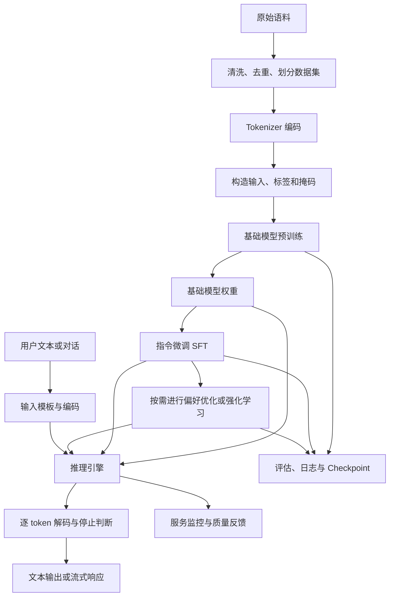

# 从零实现完整 LLM：组件全景与实现路线

本文以**自回归、仅解码器（Decoder-only）的文本语言模型**为主线，整理从数据准备、模型结构、训练到推理部署涉及的组件，并对应本仓库已有实现。

阅读导航：[数据](#3-数据系统) · [Tokenizer](#4-tokenizer文本与-token-id-的接口) · [模型结构](#5-模型内部组件) · [训练](#6-预训练与训练引擎) · [后训练](#7-后训练从续写模型到对话模型) · [推理](#9-推理与文本生成) · [仓库对照](#12-本仓库已具备哪些组件) · [实现顺序](#14-推荐实现顺序与验收标准)。

这里的“完整”分为三个层次：

| 目标 | 应具备的能力 | 主要组件 |
| --- | --- | --- |
| 可训练的基础语言模型 | 从文本中学习，预测下一个 token，生成文本 | 数据、Tokenizer、Transformer、损失函数、优化器、生成循环 |
| 可复现、可评估的对话模型 | 可靠保存和恢复训练，遵循指令，进行多轮对话 | 配置、Checkpoint、评估、SFT、对话模板；按需加入偏好优化 |
| 可提供服务的 LLM 系统 | 接收并发请求，控制资源使用，监测质量与性能 | 推理引擎、请求调度、API、监控、版本管理及按场景设置的防护 |

**这些组件不需要一次全部实现。** 对于本仓库，先完善小模型的训练与生成闭环，再扩展对话训练和推理效率。本文的模块拆分和开发顺序是面向该学习项目的建议，不是所有模型必须遵循的标准。

## 1. 先确定模型边界

| 架构 | 核心结构 | 典型用途 | 是否作为本文主线 |
| --- | --- | --- | --- |
| Decoder-only | 因果自注意力，逐 token 生成 | 文本续写、聊天、代码生成 | 是 |
| Encoder-only | 双向自注意力 | 文本表示、分类、检索编码 | 否，可作为辅助模型 |
| Encoder-decoder | 编码器、解码器、交叉注意力 | 翻译、摘要、条件生成 | 否 |
| 其他序列架构 | 状态空间、循环结构或混合结构等 | 根据目标选择 | 否，属于替代路线 |

在本文主线中，不需要额外实现一个 Encoder，也不需要默认加入 Cross-attention。原始 Transformer 采用编码器和解码器结构；实现 GPT 一类模型时，要采用其中适用于因果生成的结构。[原始 Transformer 论文](https://arxiv.org/abs/1706.03762)

## 2. 整体数据流



Tokenizer、模型结构配置和权重需要配套保存。相同的 token ID 在训练和推理时必须具有相同含义。

## 3. 数据系统

### 3.1 原始语料到训练数据

| 组件 | 作用 | 实现要点 |
| --- | --- | --- |
| 语料接入 | 读取文本、网页、代码、书籍或领域数据 | 保留来源、版本、授权信息与处理记录 |
| 文本提取 | 从原始格式中提取正文 | 处理编码错误、HTML、导航栏和重复模板 |
| 规范化 | 统一必要的文本表示 | 明确 Unicode 与换行规则；代码中的空格和缩进不能随意删除 |
| 质量过滤 | 剔除乱码、低质量重复内容等 | 结合语言识别、长度、重复率及任务需求设置规则 |
| 敏感信息处理 | 按数据使用场景处理个人信息、密钥等内容 | 记录处理规则和保留范围 |
| 去重 | 降低重复训练、记忆和评测污染 | 同时考虑精确重复、近似重复和跨数据集重复 |
| 数据集划分 | 构建训练集、验证集和测试集 | 优先按文档、来源或时间划分；不要先生成高度重叠的窗口再随机划分 |
| 评测污染检查 | 避免训练数据包含评测题及答案 | 独立检查基准集和内部测试集的重叠 |
| 数据混合 | 控制语言、领域、代码等语料比例 | 保存采样权重，并记录实际消耗的 token 数 |
| 编码与持久化 | 将语料转换为 token ID | 按规模选择分片、二进制文件、内存映射或流式读取 |
| 数据版本管理 | 使实验结果可解释、可复现 | 保存数据清单、校验值和预处理配置 |

学习阶段可以从一份纯文本文件开始；扩展到多文档时，再逐项加入上述处理。

### 3.2 训练样本与批次

基础 next-token prediction 的输入和标签通常错开一位：

```text
原始 token： [A, B, C, D, E]
input_ids：  [A, B, C, D]
labels：     [B, C, D, E]
```

| 组件 | 作用 | 注意事项 |
| --- | --- | --- |
| Dataset | 描述样本读取和采样方式 | 明确是文档采样、连续 token 流还是对话样本 |
| DataLoader / 迭代器 | 批量加载、打乱、预取和分布式分片 | 恢复训练时要能恢复数据进度或说明恢复限制 |
| Collator | 组装一个 batch | 处理变长序列、padding、标签和掩码 |
| 序列截断 | 将输入限制在上下文范围内 | 对话截断后要保留可解释的角色与回答边界 |
| Packing | 将多个短样本放入同一序列 | 明确是否允许跨文档注意力、如何插入分隔符和设置位置 |
| Padding | 补齐变长 batch | padding 不应参与有效训练目标，也不应作为有效上下文被关注 |
| 标签构造 | 为每个有效位置指定预测目标 | 标签只移位一次，避免 Dataset 与模型内部重复移位 |

连续预训练语料可以用文档分隔符连接；独立对话样本若不应互相影响，则需要隔离注意力。仅把标签设为忽略值，不会阻止样本之间相互关注。

## 4. Tokenizer：文本与 token ID 的接口

Tokenizer 不是可训练 Transformer 的一层，但它决定词表、序列长度以及文本如何进入模型。

| 组件 | 作用 | 常见选择 |
| --- | --- | --- |
| 编码规则 | 将文本转换为 token ID | 固定字节编码、BPE、Unigram 等 |
| 预处理与预切分 | 在子词算法之前处理文本 | Unicode 规范化、正则切分等，规则必须固定 |
| 词表 | 定义 token 与 ID 的对应关系 | 词表大小决定嵌入表和输出层维度 |
| 算法产物 | 保存分词规则 | BPE merges、Unigram 模型等，取决于算法 |
| 特殊 token | 表达边界和控制信息 | BOS、EOS、PAD、角色边界等，按模型设计选择 |
| encode / decode | 文本与 token ID 互转 | 检查空格、换行、中文、emoji 与特殊 token 行为 |
| 对话模板 | 将结构化消息序列化 | system/user/assistant/tool 角色和轮次结束标记 |
| 分词评估 | 评估覆盖情况和编码效率 | 检查不同语言与代码的 token 长度分布 |

固定字节编码的基础词表只有 256 个值，容易实现；一个中文字符通常占多个 UTF-8 字节，因此其上下文长度按字节 token 计算。Byte-level BPE 会进一步学习字节序列的合并规则，与固定字节编码不同。

实现时还要注意：

- 如果在 256 个字节值之外增加特殊 token，需要扩大词表并调整编码逻辑。
- 对话训练与推理要复用同一模板，明确“回答开始”和“回答结束”的标记。
- 词表或 token ID 映射变化后，旧模型权重通常不能直接按新映射解释。
- 流式输出需要增量解码，避免在不完整的 UTF-8 字节处破坏字符。

## 5. 模型内部组件

### 5.1 核心结构

以常见的 Pre-Norm Decoder-only Transformer 为例：

```text
token IDs
  → Token Embedding
  → 位置处理：绝对位置嵌入，或在各层注意力中应用 RoPE 等机制
  → N 个 Transformer Block
      ├─ Norm → Causal Self-Attention → Residual Add
      └─ Norm → Feed-Forward Network → Residual Add
  → Final Norm
  → LM Head
  → logits
      ├─ 训练：与 labels 计算交叉熵
      └─ 推理：选取最后有效位置，进行采样或贪心选择
```

| 组件 | 作用 | 常见实现与选择 |
| --- | --- | --- |
| 模型配置 | 定义结构与数值行为 | 词表、上下文长度、层数、隐藏维度、头数、FFN 维度、精度等 |
| Token Embedding | 将离散 ID 映射为向量 | 查找大小为 `V × D` 的可训练矩阵 |
| 位置机制 | 让模型利用序列顺序 | 可学习绝对位置、正弦位置、RoPE、ALiBi 等，选择一种路线 |
| Transformer Block | 重复堆叠的计算单元 | 注意力、FFN、归一化和残差连接 |
| 归一化 | 调节特征尺度、帮助训练 | LayerNorm 或 RMSNorm；明确 Pre-Norm / Post-Norm 布局 |
| Q/K/V 投影 | 构造查询、键和值 | 独立线性层或融合线性层 |
| 注意力打分 | 计算当前位置对上下文的相关性 | 缩放点积 `QKᵀ / sqrt(d_h)` |
| 因果掩码 | 保证训练与自回归推理一致 | 禁止关注未来 token |
| 注意力 Softmax | 将分数转成注意力权重 | 沿被关注的 key 位置归一化 |
| 多头组织 | 在多个子空间中聚合上下文 | MHA、MQA 或 GQA |
| 注意力输出投影 | 合并注意力头的结果 | 拼接各头后映射回隐藏维度 |
| 前馈网络 FFN / MLP | 对每个位置进行非线性变换 | 两层 GELU MLP 或门控 SwiGLU 等 |
| 激活函数 / 门控 | 提供非线性或特征选择 | GELU、SiLU、SwiGLU 等 |
| 残差连接 | 保持信息和梯度传播路径 | 将子层输入与输出相加 |
| Dropout | 按设计进行正则化 | 可选；训练和推理行为不同 |
| Final Norm | 规范化最后一层隐藏状态 | 常见于 Pre-Norm 模型 |
| LM Head | 从隐藏状态预测词表分数 | 输出维度为 `V` 的线性层 |
| 权重共享 | 减少参数并关联输入输出表示 | 可选，让 LM Head 与 Token Embedding 共享权重 |
| 参数初始化 | 设置合理的训练起点 | 显式规定权重、偏置与残差分支初始化策略 |

LayerNorm、GELU 和可学习绝对位置足以构成完整的小型 GPT。另一种常见组合是 RMSNorm、SwiGLU 和 RoPE；它们是结构选择，不应被理解为“缺少其中任何一项就不是 LLM”。[Llama 2 的结构与训练说明](https://arxiv.org/html/2307.09288v2)

### 5.2 张量形状

记 `B` 为 batch size，`T` 为输入长度，`V` 为词表大小，`D` 为隐藏维度，`Hq` 为查询头数，`Hkv` 为键值头数，`d_h` 为头维度，`F` 为 FFN 中间维度。下面采用常见的 `D = Hq × d_h` 设计：

| 数据 | 形状 |
| --- | --- |
| 输入 token ID、标签 | `[B, T]` |
| Embedding / 隐藏状态 | `[B, T, D]` |
| Q | `[B, Hq, T, d_h]` |
| K、V | `[B, Hkv, T, d_h]` |
| MHA 注意力分数 | `[B, Hq, T, T]` |
| FFN 中间激活 | `[B, T, F]`；SwiGLU 有两条中间投影分支 |
| 输出 logits | `[B, T, V]` |
| 平均训练损失 | 标量 |

MHA 中 `Hkv = Hq`；MQA 中 `Hkv = 1`；GQA 在两者之间共享键值头，通常要求 `Hq % Hkv == 0`。GQA 主要减少 K/V 投影和缓存开销，不会消除所有查询头的注意力计算。[GQA 论文](https://arxiv.org/abs/2305.13245)

### 5.3 核心计算

以下公式省略部分偏置、Dropout 和 batch/head 维度，用来说明组件如何连接。

**单头因果注意力：**

```text
Q = X Wq
K = X Wk
V = X Wv
S = Q Kᵀ / sqrt(d_h) + M
A = softmax(S, dim=key_position)
Attention(X) = A V

M[i, j] = 0，若 j <= i 且该 key 位置有效
M[i, j] = -∞，若该位置不可见
```

**一个 Pre-Norm Block：**

```text
U = X + Attention(Norm(X))
Y = U + FFN(Norm(U))
```

**两种前馈网络：**

```text
GELU MLP(X) = GELU(X W1) W2
SwiGLU(X)   = (SiLU(X W_gate) ⊙ (X W_up)) W_down
```

SwiGLU 有三组主要投影矩阵。比较不同 FFN 时，要一起比较中间维度和参数量，不能直接沿用相同的扩展倍数并假设成本相同。[GLU 变体论文](https://arxiv.org/abs/2002.05202)

**RMSNorm：**

```text
RMSNorm(x) = γ ⊙ x / sqrt(mean(x²) + ε)
```

RMSNorm 通常不执行 LayerNorm 中的减均值操作；在低精度训练中，要关注平方、求均值和归一化计算的数值精度。[RMSNorm 论文](https://arxiv.org/abs/1910.07467)

**RoPE：** 在注意力打分之前，按 token 位置旋转 Q 和 K 的成对特征；它通常不通过 `Embedding + Position Embedding` 的形式加入输入。缓存解码时，新增 token 的位置索引必须延续已有上下文。使用 RoPE 也不意味着可以不经训练与评估就任意扩大上下文长度。[RoPE 论文](https://arxiv.org/abs/2104.09864)

### 5.4 三种掩码不能混淆

| 掩码 | 解决的问题 | 是否直接决定哪些标签计算 loss |
| --- | --- | --- |
| Causal mask | 当前位置能否看到未来 token | 否 |
| Padding / 文档隔离 attention mask | 能否关注 padding 或其他独立样本 | 否 |
| Loss mask | 哪些目标位置参与训练 | 是 |

例如，SFT 常允许模型关注用户问题，但只对助手回答计算 loss。此时用户问题位置的 loss 被忽略，仍然作为有效上下文存在。

## 6. 预训练与训练引擎

### 6.1 目标函数

自回归语言模型学习：

```text
p(x₁, ..., xₙ) = ∏ p(xₜ | x₁, ..., xₜ₋₁)
loss = - sum(mₜ × log p(targetₜ | contextₜ)) / sum(mₜ)
```

`mₜ` 表示目标是否有效。基础预训练通常对有效文本 token 计算损失；padding 和被排除的目标不参与平均。实现中一般直接把 logits 传给数值稳定的交叉熵函数，不需要先显式计算词表 Softmax。

训练时可以在因果掩码下并行计算所有位置的预测；标准自回归生成通常每轮只选择一个新 token，再继续下一轮。

### 6.2 训练组件清单

| 组件 | 作用 | 建议实现内容 |
| --- | --- | --- |
| 张量与自动微分后端 | 提供矩阵运算、梯度和设备执行 | 学习项目使用 PyTorch 即可，无需从 CUDA 算子开始重写 |
| 训练入口与配置 | 统一控制实验 | 保存模型、数据、训练参数和代码版本 |
| 前向与 loss | 计算预测与训练目标 | 正确处理标签移位、有效 token 数和忽略位置 |
| 自动反向传播 | 计算参数梯度 | `loss.backward()` 或混合精度对应流程 |
| 优化器 | 根据梯度更新参数 | 常见为 AdamW；明确学习率、betas、eps、权重衰减 |
| 参数分组 | 对不同参数采用适当规则 | 显式决定偏置、归一化参数、共享权重的衰减策略 |
| 学习率调度器 | 控制训练阶段的步长 | 可先实现 warmup，再选择 cosine 或其他衰减 |
| 梯度清零 | 避免意外累积 | 明确每次 optimizer update 的边界 |
| 梯度累积 | 用多个 micro-batch 构造更大的有效 batch | 正确归一化 loss；调度器通常按参数更新步进 |
| 梯度裁剪 | 限制过大的梯度范数 | 使用缩放器时，应先 unscale 再裁剪 |
| 混合精度 | 降低内存开销并加速 | 区分 FP32、BF16、FP16；FP16 常需梯度缩放 |
| 数值检查 | 及时定位训练异常 | 记录 loss、梯度范数，检查 NaN / Inf |
| 验证循环 | 测量未参与训练的数据表现 | `eval()`、关闭梯度；验证后恢复训练模式 |
| 日志与性能统计 | 理解收敛、成本和瓶颈 | 学习率、loss、已训练 token、tokens/s、显存等 |
| Checkpoint | 保存、恢复、选择模型 | 区分供推理使用的权重和完整训练恢复状态 |
| 随机性管理 | 支持实验复现 | 保存随机种子和随机数状态，说明非确定性限制 |

### 6.3 Checkpoint 与恢复

用于恢复训练的 Checkpoint 通常包括：

- 模型权重及结构配置。
- 优化器状态、学习率调度器状态，以及使用时的梯度缩放器状态。
- 已完成的参数更新步数和已消耗 token 数。
- CPU、加速设备以及实际使用的数据处理库的随机数状态。
- 数据版本、采样器或流式迭代器进度、分布式分片信息。
- Tokenizer、特殊 token、对话模板的版本或配套文件。

优先在一次完整参数更新后保存；如果要在梯度累积中途恢复，还需保存累积梯度等中间状态。采用临时文件写入后再替换等方式，避免留下看似有效的半份 Checkpoint。

“能够加载模型”与“能够连续恢复训练”是两种验收目标。后者还需要比较恢复前后的数据顺序、学习率和优化器行为。

### 6.4 有效 batch 的计算

在各数据并行副本 micro-batch 大小相同的情况下：

```text
每次参数更新的样本数
  = 每个数据并行副本的 micro_batch_size
    × 梯度累积次数
    × 数据并行副本数
```

固定长度且无 padding 时，再乘序列长度，可得输入 token 数。有效训练目标数应按实际 loss mask 统计。张量并行或流水线并行设备共同处理同一批样本，不能把所有设备数量都乘进去。

变长样本或不同副本的有效 token 数不同时，需要按全局有效目标数正确归一化，避免简单平均各 micro-batch 的均值造成训练权重偏差。

## 7. 后训练：从续写模型到对话模型

基础模型训练完成后，可以直接用于文本续写。若目标是聊天、指令执行或特定推理任务，再按需求加入以下阶段。

### 7.1 指令微调 SFT

| 组件 | 作用 | 实现要点 |
| --- | --- | --- |
| 指令与对话数据 | 提供输入和期望回答 | 覆盖目标任务、语言、格式及多轮场景 |
| 对话模板 | 将角色消息转换为 token 序列 | 训练、评测、推理使用同一规则 |
| 回答区域标记 | 决定训练哪些 token | 常见做法是只对助手回答和相应结束标记计算 loss |
| 截断与样本过滤 | 控制上下文长度 | 检查是否仍有有效回答目标，避免分母为零 |
| 微调训练器 | 在基础权重上继续训练 | 复用训练引擎，并独立配置学习率、训练量和评估 |
| 对话能力评估 | 检查能否遵循要求 | 多轮一致性、输出格式、事实性和任务成功率 |

SFT 通常继续使用交叉熵损失，并不需要额外发明一套注意力结构。示范数据训练与后续人类偏好优化是可分开的阶段。[InstructGPT 论文](https://arxiv.org/abs/2203.02155)

### 7.2 偏好优化与强化学习

| 路线 | 主要数据与组件 | 何时考虑 |
| --- | --- | --- |
| DPO | 相同问题下的 chosen / rejected 回答、策略模型、通常冻结的参考模型、偏好损失 | 已有成对偏好数据，希望先实现较简单的偏好训练 |
| 典型 PPO 式 RLHF | 偏好数据、奖励模型、策略模型、参考模型、rollout、价值估计及 PPO 更新 | 需要通过在线生成和奖励反馈改进行为 |
| 可验证奖励强化学习 | 任务、生成采样器、答案检查器或测试器、策略更新 | 数学、代码等能定义较可靠奖励的任务 |
| GRPO 等策略更新方法 | 同一问题的多份采样、奖励与组内相对优势、策略优化 | 按实际奖励设计和训练目标选择 |

经典 DPO 直接利用偏好对优化策略，不要求先训练一个独立奖励模型，也不要求在每个训练步骤中在线生成回答。[DPO 论文](https://arxiv.org/abs/2305.18290)

GRPO 通过组内相对奖励构造优势，省去传统 PPO 中的独立价值模型；它是可选的训练算法。实现强化学习时还需关注采样成本、奖励可靠性、长度偏差和奖励投机。[DeepSeekMath / GRPO 论文](https://arxiv.org/abs/2402.03300)

### 7.3 参数高效微调

| 方法 | 作用 | 与训练目标的关系 |
| --- | --- | --- |
| 全参数微调 | 更新全部或大部分基础权重 | 直接但优化器与梯度内存开销较大 |
| LoRA | 冻结基础权重，训练低秩增量矩阵 | 可搭配 SFT 或偏好训练 |
| QLoRA 一类方案 | 在量化基础权重上训练适配器 | 需要配套量化、计算精度与适配器保存逻辑 |

LoRA 是“更新哪些参数”的选择；SFT、DPO 等是“用什么数据和目标训练”的选择，两者可以组合。LoRA 不能替代随机初始化模型所需的基础能力学习。[LoRA 论文](https://arxiv.org/abs/2106.09685)

## 8. 评估与正确性验证

评估需要贯穿训练和部署，不能仅靠训练 loss 或几段生成样例判断模型是否完成。

| 评估层次 | 关注内容 | 可采用的检查 |
| --- | --- | --- |
| 组件正确性 | 张量形状、掩码、标签、位置索引 | 修改未来 token 不改变此前位置的预测；屏蔽位置不参与目标 |
| 训练闭环 | 梯度是否正常、模型是否学到数据 | 在极小数据上过拟合，检查有效参数有梯度、loss 有限 |
| 泛化表现 | 未参与训练的文本预测能力 | 独立验证集和测试集的 token 平均 loss、困惑度 |
| 任务能力 | 是否完成目标任务 | 根据目标选择阅读理解、代码、数学、中文等评测 |
| 对话质量 | 是否遵循要求、保持上下文 | 多轮测试、格式约束、人工抽查或有校准的模型评审 |
| 长上下文 | 是否利用较早的信息 | 不同长度和信息位置的检索、推理与鲁棒性测试 |
| 推理一致性 | 缓存和优化是否改变语义 | 对比全量前向与缓存解码的 logits，使用数值容差 |
| 保存与恢复 | 权重和训练状态是否完整 | 保存加载前后的输出；恢复后的步数、数据进度和学习率 |
| 运行性能 | 成本与响应是否达标 | 吞吐量、首 token 延迟、后续 token 延迟、峰值显存 |
| 场景防护 | 系统是否按产品约束工作 | 按实际场景评估隐私泄露、提示注入、工具权限与错误处理 |

困惑度可按 `PPL = exp(平均 token 交叉熵)` 计算，前提是交叉熵使用自然对数。比较 PPL 时，要保持 Tokenizer、数据、上下文与有效目标定义一致；字节 token 的 PPL 不能直接和另一种子词 Tokenizer 的 PPL 比高低。

训练中用验证集选择模型和调参，最终测试集用于独立报告。性能报告应同时记录硬件、精度、batch、输入输出长度、并发量和测量边界。

## 9. 推理与文本生成

### 9.1 生成所需组件

| 组件 | 作用 | 实现要点 |
| --- | --- | --- |
| 模型加载器 | 加载配置、词表和权重 | 检查结构、token ID、精度和设备是否匹配 |
| 输入格式化 | 构造续写输入或对话输入 | 复用训练模板，保留回答开始标记 |
| 上下文管理 | 控制输入长度与对话历史 | 预留输出空间，定义截断或摘要策略 |
| Prefill | 一次处理提示词 | 得到各层上下文 K/V 和下一 token 的 logits |
| Decode loop | 将新 token 逐步追加 | 每轮执行前向、选择 token、更新状态和停止判断 |
| Logits 处理 | 在选择 token 前调整分布 | 按需求处理禁用 token、重复惩罚和结构约束 |
| 解码策略 | 决定输出哪个 token | 贪心、temperature、top-k、top-p；beam search 按任务选择 |
| 停止条件 | 判断回答是否结束 | EOS / 回合结束标记、最大新 token 数、停止字符串、取消信号 |
| 增量解码 | 将 token 流转成文本 | 正确处理子词、字节边界、特殊 token 和停止字符串 |
| 批量生成 | 同时处理多个输入 | 对齐 padding、位置索引、缓存长度与独立停止状态 |

温度采样通常计算 `softmax(logits / temperature)`；贪心选择应使用明确的 `argmax` 分支，避免用温度零进行除法。Top-k 保留分数最高的若干候选，top-p 保留累计概率达到阈值的最小候选集合。

推理应关闭训练用 Dropout，并禁用不必要的梯度记录。`model.eval()` 和 `no_grad()` / `inference_mode()` 分别控制不同的行为，需要按实际后端使用。

### 9.2 KV Cache

KV Cache 保存每层已经处理的 token 的 K 和 V，减少重复计算，是提升自回归推理效率的重要组件。

| 子组件 | 职责 |
| --- | --- |
| 缓存存储 | 为每层保存 K/V 张量及其容量 |
| 缓存长度与写入位置 | 指明已有 token 数、新 token 写入位置和有效范围 |
| 位置管理 | 为新增 token 使用正确的绝对位置或 RoPE 位置 |
| 缓存注意力 | 让新增 query 关注可见的历史 key 与自身 |
| 请求隔离 | 分别维护不同请求、不同样本的缓存 |
| 分配与释放 | 请求完成、取消或超时后回收内存 |

单个新 token 解码时，query 长度可能为 1，key 长度则包含全部历史。必须根据实际绝对位置构造可见关系，不能直接套用假设 Q/K 同长的下三角掩码。特别是 PyTorch SDPA 的非方阵 `is_causal=True` 有特定对齐语义，需要按所用版本核实；使用 SDPA 时还应在评估阶段显式传入零 Dropout。[PyTorch SDPA 文档](https://docs.pytorch.org/docs/stable/generated/torch.nn.functional.scaled_dot_product_attention.html)

### 9.3 推理优化

| 组件 | 解决的问题 | 是否需要先实现 |
| --- | --- | --- |
| 融合算子与编译 | 减少算子调度和中间读写开销 | 正确性基线建立后再做 |
| 高效注意力内核 | 降低完整注意力的中间存储和访存 | 按设备、精度与形状选择 |
| 量化 | 减少权重、激活或缓存的存储与带宽 | 明确量化对象，验证任务质量与实际速度 |
| 前缀缓存 | 在可安全共享时复用共同前缀的计算 | 注意内容、位置和模板必须一致 |
| Continuous batching | 在生成步骤之间动态加入或移除请求 | 面向并发服务时考虑 |
| 分页 KV 管理 | 降低动态缓存的碎片和重复占用 | 面向较高并发时考虑 |
| 投机解码 | 用草稿生成与主模型验证提高解码效率 | 需要配套接受规则、分布正确性和性能评估 |

FlashAttention 是完整注意力的高效计算方式，通过分块和减少访存避免显式保存完整注意力矩阵；它不自动把稠密注意力的计算复杂度从关于序列长度的二次量级变成线性量级。[FlashAttention 论文](https://arxiv.org/abs/2205.14135)

PagedAttention 关注 KV Cache 的分页管理与共享，可作为理解服务端缓存管理的参考。[PagedAttention / vLLM 论文](https://arxiv.org/abs/2309.06180)

## 10. 规模扩展与资源规划

### 10.1 训练扩展组件

| 组件 | 作用 | 适用条件 |
| --- | --- | --- |
| 数据并行 DDP | 各副本处理不同数据并同步梯度 | 单份模型与训练状态能放入单设备，需要提高吞吐量 |
| 状态分片 FSDP / ZeRO | 分片参数、梯度、优化器状态等 | 单设备内存不足，且可承担相应通信开销 |
| 张量并行 TP | 将单层矩阵运算分配给多个设备 | 单层较大，需要较高带宽的设备互联 |
| 流水线并行 PP | 将不同层分配到不同设备 | 深层模型，需要管理 micro-batch 和流水线空闲 |
| 序列 / 上下文并行 | 分摊长序列相关激活或注意力计算 | 长上下文训练，依具体算法组织通信 |
| 专家并行 EP | 将 MoE 专家分布到不同设备 | 选择了 MoE 架构 |
| 激活重计算 | 反向时重算部分前向，减少激活保存 | 用额外计算换内存 |
| CPU / 存储卸载 | 将部分训练状态移出加速设备 | 内存受限且能接受数据传输开销 |
| 分布式 Checkpoint | 保存和恢复多个分片 | 多设备训练及拓扑变化时需要设计 |
| 通信与性能分析 | 定位计算、通信和数据加载瓶颈 | 先测量，再决定并行组合 |

ZeRO 的常见阶段依次分片优化器状态、再加梯度、再加参数；应区分“提高吞吐量”和“让模型放得下”两个目的。[ZeRO 论文](https://arxiv.org/abs/1910.02054)

### 10.2 参数量、内存与计算量

以下是根据张量规模做的粗略估算，用于规划和理解，不作为实际可运行内存的保证：

```text
权重存储字节数 ≈ 参数量 × 每参数存储字节数

传统低精度 Adam 混合精度训练的一种状态组合：
  低精度权重 2P + 低精度梯度 2P + FP32 主权重 4P
  + 两份 FP32 动量 8P ≈ 16P 字节

标准多层 K/V 缓存字节数 ≈ 2 × L × B × S × Hkv × d_h × b

稠密 Transformer 的训练计算量常用粗估：
  FLOPs ≈ 6 × P × N_tokens
```

其中 `P` 为参数量，`L` 为层数，`B` 为缓存中的序列数，`S` 为每个序列已缓存长度，`b` 为缓存元素字节数。KV 公式假设各层采用相同的全长缓存结构；变长序列应按各序列长度求和。

例如十亿参数的纯 BF16 权重约占 `2 × 10^9` 字节，约 2 GB 或 1.86 GiB；这还不包括梯度、优化器、激活、KV Cache 和运行时开销。训练状态的实际字节数取决于实现，并非总是上述 16 字节。

`6PN` 是常用的稠密模型数量级估计，不能精确覆盖长序列注意力、重计算、MoE 和各类额外开销。应以实测单步耗时、峰值内存和目标训练 token 数修正预算。[Chinchilla 论文的计算量分析](https://arxiv.org/html/2203.15556v1#A6)

模型规模、语料质量、训练 token 数和资源预算需要共同确定。小模型可以完整验证架构与工程闭环，但完成组件并不自动获得大规模模型的能力。

## 11. 服务、交付与可选扩展

### 11.1 服务与模型交付

| 组件 | 作用 |
| --- | --- |
| 推理 API | 接收文本或结构化消息，校验参数，返回结果 |
| 流式传输 | 持续返回增量文本，传播取消与错误状态 |
| 请求队列与调度 | 分配 batch、计算资源和 KV Cache 容量 |
| 资源边界 | 管理输入长度、输出长度、并发、超时和配额 |
| 健康检查与错误处理 | 处理加载失败、显存不足、设备异常与服务重启 |
| 访问与数据控制 | 按场景设置鉴权、日志脱敏、数据留存和工具权限 |
| 监控 | 统计吞吐量、延迟分位数、失败率、缓存与设备内存占用 |
| 版本与回滚 | 关联模型、Tokenizer、模板、量化方式及部署配置 |
| 质量反馈 | 收集可用反馈，建立回归样例与后续训练数据闭环 |
| 模型交付包 | 提供权重、配置、编码文件、依赖、运行示例及能力和限制说明 |

部署前需分别评估基础权重版本、量化版本与实际推理后端。量化位数降低不必然带来端到端加速，收益还取决于内核支持与负载。

### 11.2 按目标增加的扩展

| 扩展 | 新增组件 | 与基础模型的关系 |
| --- | --- | --- |
| RAG 检索增强 | 文档解析与切分、检索编码器、索引、检索、重排、上下文拼接与引用 | 外部知识链路，通常不要求修改基础 Transformer |
| 工具调用 | 工具描述、调用格式训练或提示、参数校验、执行器、结果回填与循环控制 | 模型生成调用意图，由受控程序执行 |
| Agent 工作流 | 状态管理、任务分解、工具编排、重试、终止与持久化 | 围绕模型构建的应用流程 |
| 多模态输入 | 图像或音频预处理、模态编码器、投影或融合模块、对齐数据 | 对文本模型进行结构和训练扩展 |
| 多模态输出 | 相应的输出表示、生成模块与解码器 | 根据输出模态另外设计 |
| MoE | 路由器、专家网络、负载均衡、路由容量和可选专家并行 | 主要替换部分稠密 FFN，需要配套训练与通信 |
| 长上下文 | 位置扩展策略、长文本数据、注意力与缓存优化、长程任务评估 | 同时涉及结构、训练和推理 |
| 蒸馏 | 教师输出或分布、学生模型、蒸馏目标与质量评估 | 用于能力迁移或模型压缩 |
| 推理能力专项训练 | 推理数据、验证器、采样和训练预算、任务评估 | 通过数据与训练流程塑造能力，并非添加一个通用“推理层” |

这些扩展应由应用目标驱动。实现一个文本基础 LLM 不需要同时实现它们；RAG 的检索编码器也可以是独立的辅助模型。

## 12. 本仓库已具备哪些组件

以下根据编写文档时的 [model.py](model.py)、[dataset.py](dataset.py) 和 [train.py](train.py) 整理；后续实现变化时应同步更新本节。

| 部分 | 当前实现 | 可补齐或扩展的内容 |
| --- | --- | --- |
| 编码 | `dataset.py` 使用 UTF-8 固定字节 ID，词表为 256 | 独立 encode/decode 接口、特殊 token、可选子词分词 |
| 数据划分与采样 | 前 90% / 后 10% 划分，随机采样固定长度窗口 | 多文档划分、数据版本、变长样本和 padding |
| 标签 | `get_batch()` 已构造错开一位的目标 | 明确接口约定，增加按需 loss mask |
| 模型配置 | `ModelConfig` 保存词表、上下文、维度、头数、层数和 Dropout | 外部配置与配置持久化、参数合法性检查 |
| Embedding | token 嵌入和可学习绝对位置嵌入 | 保留基线，按学习目标添加 RoPE 等变体 |
| 注意力 | 融合 QKV 投影、MHA、显式因果掩码和输出投影 | padding mask、KV Cache、可选 GQA 和高效内核 |
| Block | Pre-LayerNorm、残差、GELU FFN 和 Dropout | 保留基线，按需增加 RMSNorm / SwiGLU |
| 输出 | Final LayerNorm、LM Head、输入输出权重共享 | 导出与加载完整配置，支持不同训练目标掩码 |
| 训练 | 交叉熵、自动微分、AdamW、固定学习率 | 调度器、梯度裁剪、累积、混合精度与 Checkpoint |
| 验证 | 随机批次估计训练和验证 loss | 固定评估集、token 加权指标及生成回归样例 |
| 生成 | 裁取最近上下文、全量重算、按 Softmax 分布采样 | 停止 token、temperature / top-k / top-p、KV Cache |
| 对话与后训练 | 尚未实现 | 对话模板、SFT 数据与回答区域掩码 |
| 服务化 | 尚未实现 | 推理 API、流式响应、资源管理与监控 |

当前代码已经覆盖基础语言模型的主要计算链路。建议优先补齐持久化、评估和可控生成，再根据资源与目标扩展模型结构。

## 13. 建议的模块拆分

当前三个 Python 文件适合阅读。随着功能增加，可以逐步演化为下面的结构；这是规划示例，不表示这些文件已经存在，也不要求立刻重构。

```text
configs/                 模型、训练、数据和推理配置
llm/
  tokenizer.py           编码、解码、特殊 token 与模板
  data/
    preprocess.py        清洗、去重、划分与离线编码
    dataset.py           数据读取与样本采样
    collator.py          padding、packing 与各类掩码
  model/
    config.py            模型结构配置
    attention.py         QKV、因果注意力与缓存接口
    position.py          位置嵌入或 RoPE
    norm.py              LayerNorm / RMSNorm
    feed_forward.py      GELU MLP / SwiGLU
    transformer.py       Block、完整模型与输出层
  training/
    trainer.py           训练、累积、精度与日志
    optimizer.py         参数分组、优化器与调度器
    checkpoint.py        保存、恢复与版本元数据
    distributed.py       按需加入的并行与通信逻辑
  post_training/
    sft.py               指令微调
    preference.py        按需加入的偏好训练
  inference/
    generation.py        生成循环、采样与停止
    kv_cache.py          缓存存储、写入和回收
    engine.py            prefill、decode 与批处理
  evaluation/            指标、任务评估与性能测量
  serving/               API、队列与监控
scripts/                 预处理、训练、评估、聊天和导出入口
tests/                   关键正确性与恢复、缓存一致性检查
artifacts/               权重、配置、Tokenizer 和实验记录
```

## 14. 推荐实现顺序与验收标准

下面是开发路线；未勾选项表示待完成的里程碑，不代表本仓库完全没有对应基础。

### 阶段一：巩固基础模型闭环

- [ ] 固定并记录编码、样本移位、结构和训练配置。
- [ ] 验证模型可以在极小数据上过拟合，并且因果注意力不会泄露未来信息。
- [ ] 保存并重新加载权重和配套配置，确认输出一致。
- [ ] 增加可控采样、最大生成长度，以及设计了结束 token 时的停止逻辑。

**验收：** 从语料训练模型，保存后重新加载，仅依靠交付文件完成一次可解释的文本生成。

### 阶段二：完善训练工程与评估

- [ ] 加入完整 Checkpoint、恢复逻辑和数据版本记录。
- [ ] 加入固定验证流程、有效 token 加权统计、日志和异常检查。
- [ ] 按训练需要增加学习率调度、梯度裁剪、累积和混合精度。
- [ ] 将数据处理扩展到多个独立文档，检查划分与重复数据。

**验收：** 中断后可按约定恢复训练；能够说明模型使用了哪些数据、训练多少 token、验证表现如何。

### 阶段三：实现对话能力

- [ ] 定义角色边界、回合结束标记和统一对话模板。
- [ ] 构造 SFT 数据，正确处理回答区域的 loss mask。
- [ ] 支持多轮输入、历史截断与回答停止。
- [ ] 建立与实际目标一致的指令和多轮评估；有需求时再加入 DPO 等训练。

**验收：** 模型能按模板进行多轮交互，且目标任务表现通过预先定义的评估。

### 阶段四：提升效率并提供服务

- [ ] 实现 KV Cache，对比缓存解码与全量前向结果。
- [ ] 根据实测瓶颈选择高效内核、量化或分布式方案。
- [ ] 提供批量或流式推理 API，处理取消、超时和资源回收。
- [ ] 建立部署版本、性能指标、质量回归和回滚流程。

**验收：** 在指定硬件、输入输出长度和并发量下，达到约定的质量、延迟、吞吐量与内存目标。

### 阶段五：按应用目标扩展

- [ ] 从 RAG、工具调用、多模态、MoE、长上下文等方向中选择实际需要的一项。
- [ ] 为扩展定义独立指标，评估它是否改善目标任务，以及增加了多少资源与维护成本。

**验收：** 每项扩展都有明确输入输出、可复现评估和可说明的收益。
